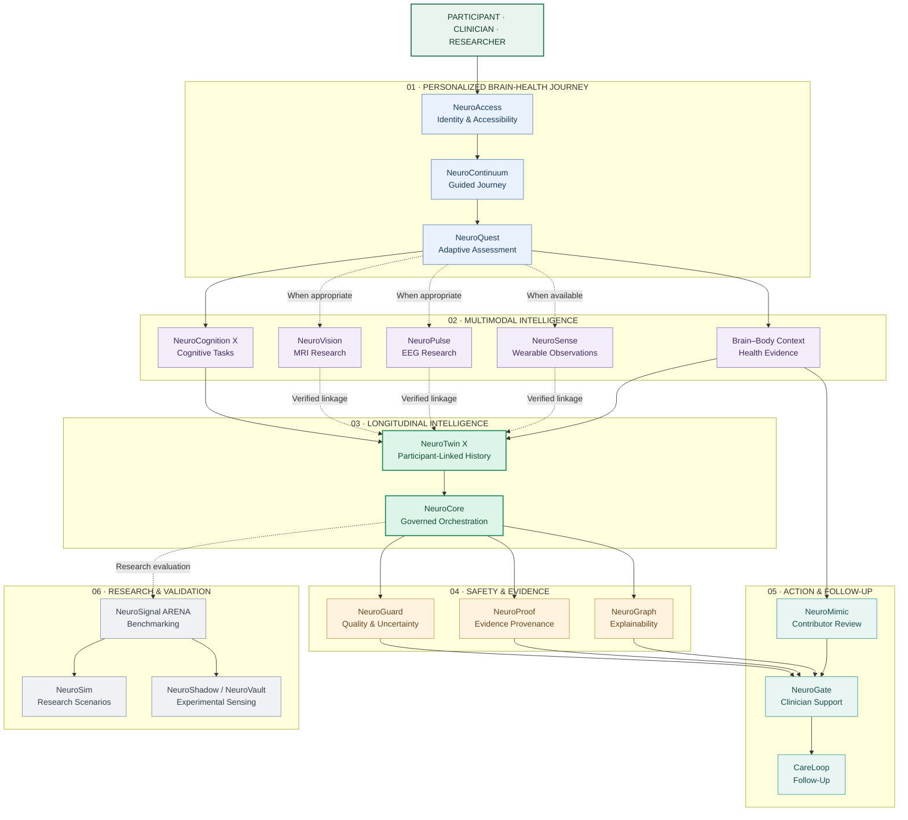

# 🧠 BAINP
### Brain AI & Neurointelligence Platform

**Connecting Brain Intelligence With Responsible Healthcare Action**

BAINP 3.0 is an AI-assisted, multimodal brain-health research and monitoring platform designed to connect cognitive assessments, neuroimaging, EEG, wearable observations, longitudinal intelligence and evidence-aware clinical support.

Developed for the **Future Health Digital Innovation Challenge 2026 — Protecting Brain Health Earlier**, BAINP aims to improve how brain-health information is collected, connected, evaluated and translated into appropriate next steps.

> **Status:** Research-stage prototype under active development. BAINP is not a clinically validated diagnostic system or medical device approved for clinical use.

---

## The Problem

Brain-health information is often fragmented across:

- Cognitive assessments and functional observations
- MRI and other neuroimaging investigations
- EEG and neural electrophysiology
- Wearable and physiological measurements
- Medical history, sleep and lifestyle factors
- Longitudinal records and clinical follow-up

Fragmentation can make it difficult to compare observations, identify meaningful changes, assess evidence quality and support appropriate follow-up.

BAINP investigates whether an integrated, accessible and evidence-aware workflow can address these challenges.

## Our Solution

BAINP combines three complementary capabilities:

**1. Adaptive Brain-Health Assessment**

Accessible, guided cognitive assessments with transparent assessment selection, recorded performance and longitudinal monitoring.

**2. Multimodal Neuroscience Intelligence**

Research workspaces for MRI, EEG, wearable signals, cognitive observations and integrated brain-health modeling.

**3. Responsible AI and Clinical Support**

Evidence verification, uncertainty handling, reproducible benchmarking and clinician-supervised follow-up.

---

## BAINP Research Engines

| Engine | Purpose |
|---|---|
| NeuroAccess | Accessible onboarding, consent and assessment readiness |
| NeuroContinuum | Guided brain-health journey |
| NeuroQuest | Adaptive assessment selection |
| NeuroCognition X | Cognitive assessment and performance tracking |
| NeuroVision | MRI processing, visualization and anatomical research |
| NeuroPulse | EEG signal processing and neural research |
| NeuroSense | Movement, sleep and physiological observations |
| NeuroTwin X | Longitudinal multimodal brain-state representation |
| Brain–Body Context | Authorized whole-person health information |
| NeuroCore | AI orchestration and controlled model improvement |
| NeuroGuard | Safety, evidence quality and uncertainty |
| NeuroGraph | Explainable evidence relationships |
| NeuroProof | Measurement provenance and evidence passports |
| NeuroShadow | Consented behavioral research observations |
| NeuroMimic | Potential contributors to cognitive changes |
| NeuroGate | Clinician-supervised assessment decision support |
| NeuroSim | Prevention education and research scenarios |
| CareLoop | Clinical review and follow-up workflows |
| NeuroSignal ARENA | Reproducible research benchmarking |

Module implementation and validation status vary. Some features are experimental, and others are part of the planned architecture.

---

## How BAINP Works

This represents the intended architecture. It does not imply that all integrations are operational or that incompatible research datasets are combined into a single participant record.

---

## Scientific Research

BAINP investigates several complementary research areas:

### Cognitive Intelligence

- Digital cognitive assessment
- Attention, memory and executive functioning
- Trial-level performance analysis
- Assessment quality and comparability
- Longitudinal change monitoring

### Neuroimaging

- Structural MRI visualization
- Anatomical segmentation and regional measurements
- Image quality and provenance
- Longitudinal anatomical research
- Experimental 3D brain representations

### EEG Research

- Prerecorded EEG waveform playback
- Spectral feature extraction
- Signal quality and artifact evaluation
- Research cohort benchmarking
- Future real-time EEG integration

### Wearable and Physiological Intelligence

- Movement and activity research
- Sleep and physiological observations
- Wearable data quality
- Personal change tracking
- Multimodal brain–body associations

### NeuroTwin X

NeuroTwin X is a research framework for organizing compatible participant-linked observations across time.

It does not reconstruct an individual's complete biological brain or establish exact neurological disease-onset dates.

---

## Research Datasets

The research programme considers authorized and appropriately licensed datasets, including:

| Dataset | Research area |
|---|---|
| ADNI | Longitudinal clinical and neuroimaging research |
| OASIS | Structural MRI and longitudinal analysis |
| OpenNeuro | EEG research |
| PADS | Wearable movement research |

Dataset access, licensing, permitted use and publication restrictions must be verified independently.

**Research data governance:**

- Restricted participant data must not be committed to this repository.
- Research datasets remain separate unless legitimate participant linkage exists.
- Public demonstrations should use synthetic or explicitly permitted data.
- Research outputs must preserve source provenance and interpretation limitations.

---

## Technology Architecture

The proposed platform uses:

**Frontend**
- Next.js
- React
- TypeScript

**Backend**
- Python
- FastAPI
- Validated service APIs

**Data**
- PostgreSQL
- Structured assessment records
- Governed research storage

**Scientific Computing**
- NumPy, SciPy and statistical modeling
- scikit-learn
- Neuroimaging libraries
- EEG signal-processing frameworks

**Infrastructure**
- GitHub
- Docker
- Cloud deployment and monitoring

Exact implementation dependencies and versions should be taken from the verified application source.

---

## Responsible AI and Safety

BAINP follows these design principles:

1. Human oversight for clinical decisions.
2. No unsupported autonomous diagnoses.
3. Explicit uncertainty and insufficient-evidence handling.
4. Transparent research-data provenance.
5. Participant-level access control and consent.
6. Separate evaluation of research algorithms.
7. Controlled and validated model updates.
8. Clear differentiation between observed data, estimates and hypotheses.

A model's predictive performance on retrospective data is not equivalent to prospective clinical validation.

---

## Future Roadmap

### NeuroPulse Hardware

Develop a proposed non-invasive wearable EEG research device capable of acquiring neural electrical signals and transmitting them to compatible BAINP software.

Research priorities include electrode selection, acquisition quality, artifact reduction, human factors, electrical safety and validation against appropriate reference equipment.

### Advanced NeuroTwin

Expand participant-specific representations using compatible longitudinal MRI, EEG, cognitive and physiological observations.

### Adaptive Intelligence

Investigate calibrated assessment selection, uncertainty-aware monitoring and governed model improvement.

### Clinical and Population Research

Conduct appropriate usability studies, longitudinal validation, external benchmarking and clinician-supervised feasibility evaluations.

The future roadmap is subject to technical feasibility, ethics, funding, data permissions and applicable regulation.

---

## Repository and Development Status

This repository is intended to organize the BAINP software platform, scientific modules, research workflows, tests and documentation.

The currently published branch may not contain all locally developed modules. Features should be considered available only when their source, dependencies and tests are present and verified.

Production deployment instructions will be documented after verification of the release branch, build configuration and environment requirements.

---

## Intended Use

BAINP is designed for research, education, prototype evaluation and future clinician-supervised brain-health applications.

It must not be used as a substitute for professional medical assessment, diagnosis, emergency care or treatment decisions.

---

## Project

**Name:** BAINP — Brain AI & Neurointelligence Platform

**Challenge:** Future Health Digital Innovation Challenge 2026

**Problem statement:** Protecting Brain Health Earlier

**Repository:** https://github.com/smgunjikar/BAINP

**Current stage:** Research prototype

---

**BAINP — Track. Assess. Understand. Act.**
